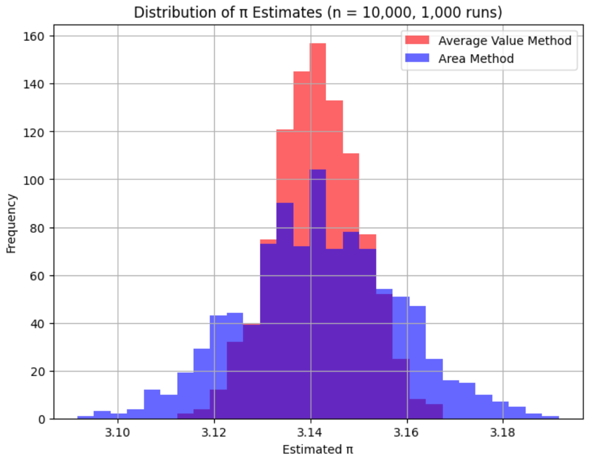

# Monte Carlo Estimation of π

This project estimates π with several Monte Carlo methods, including Buffon's Needle and quarter-circle integration. It measures how accurate and how variable each method is, and compares a standard sampler with variance-reduction techniques.



## Methods

**1. Quarter-circle integration** (`src/integral_methods.py`, `notebooks/Integral_approximation.ipynb`)
- **Average-value method:** π ≈ 4 · mean(√(1 − x²)) for uniform x in [0, 1]
- **Area (hit-or-miss) method:** π ≈ 4 · (fraction of random points that fall under the curve)

**2. Buffon's Needle** (`src/buffon.py`, `notebooks/Monte_Carlo_testing.ipynb`)
- A vectorized, chunked simulation that can handle 10⁷+ needle drops without running out of memory
- Supports both short needles (l ≤ d) and long needles (l > d)
- Compares a standard sampler with **antithetic** and **stratified** sampling

## Results

**Integration methods.** These figures come from 1,000 runs at n = 10,000 samples each.

| Method | Mean estimate | Std. error |
|---|---|---|
| Average-value | 3.14139 | 0.0089 |
| Area (hit-or-miss) | 3.14191 | 0.0163 |

The average-value method has about **half the spread** of the hit-or-miss method for the same number of samples. It uses the function's actual value at each point, not just whether the point falls above or below the curve.

**Buffon's Needle.** These are single runs with about 10⁶ drops.

| Sampler | π estimate | Abs. error |
|---|---|---|
| Standard (vectorized) | 3.141338 | 0.00025 |
| Antithetic | 3.140444 | 0.00115 |
| Stratified | 3.147452 | 0.00586 |

These are single runs, so they don't show which sampler has lower variance. A fair comparison would repeat each sampler many times and compare the spread of the estimates.

## Repository structure

```
src/integral_methods.py              Average-value and area estimators, distribution plots
src/buffon.py                        Vectorized Buffon's Needle, multi-trial averaging, visualization
notebooks/Integral_approximation.ipynb
notebooks/Monte_Carlo_testing.ipynb
figures/                             Saved plots
```

## Run it

```bash
git clone https://github.com/evan-nyhus18/monte-carlo-pi-estimation.git
cd monte-carlo-pi-estimation
pip install -r requirements.txt
jupyter notebook
```

To run the interactive Buffon's Needle simulation:

```bash
python src/buffon.py
```

**Tech stack:** Python, NumPy, matplotlib
